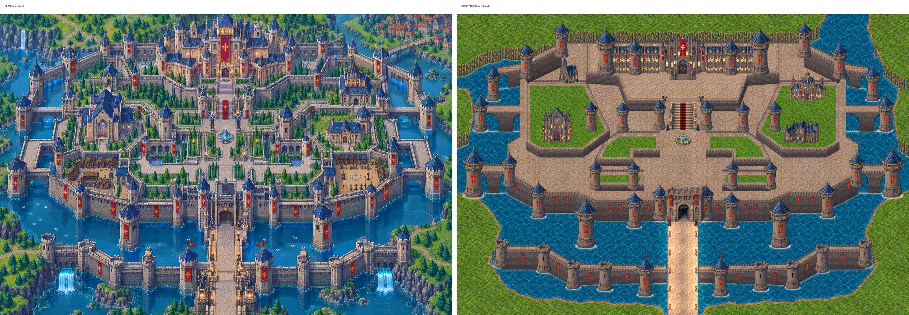

# Grand Castle Island

A 2D HD pixel-art game built in **Godot 4** (4.4+). Step 1: build the castle world.

Reference artwork: `docs/reference/castle_reference.png`

## Open it
1. `git clone` / `git pull` this repo.
2. Godot → **Import** → select `project.godot`.
3. Press **F5**. You'll see the textured island with animated water. WASD/arrows pan, the mouse wheel zooms, **R** toggles the reference castle overlay, and **N** cycles day → golden hour → night.

## Where things go
| Folder | Contents |
|---|---|
| `docs/CASTLE_OBSERVATION.md` | Full breakdown of the castle: zones, structures, palette, animations, asset checklist, build plan |
| `docs/ASSETS.md` | Every asset, what was processed/straightened, and which castle feature it belongs to |
| `docs/TEXTURE_QUALITY.md` | Render/import settings, shaders, rules for new art |
| `shaders/` | Water, terrain and shore-foam shaders |
| `docs/reference/` | The reference artwork |
| `assets/tilesets/` | terrain, water, walls, floors, roofs |
| `assets/sprites/` | towers, buildings, statues, banners, props, vegetation, ambient |
| `assets/effects/` | torch, water, waterfall animations |
| `scenes/castle/Castle.tscn` | Main castle scene: ground, water, Y-sorted structures |
| `scenes/castle/parts/` | Reusable pieces: `Tower`, `BarbicanTower`, `GateTower`, `CurtainWall` (set `length` and `wall_tile` in the inspector), `Gatehouse`, `WideWaterfall`, `KnightStatue`, `LanternPillar`, `Brazier`, `Islet`, `Palace`, `GrandStairs`, `Gargoyle`, `KnightStatueTall`, `Cathedral`, `Chapel`, `DomedHall`, `Manor`, `FountainPlaza`, `CypressPlanter`, trees (`PineA`–`D`, `CypressA`–`C`, `Bush*`). Bridges reuse `CurtainWall` with `wall_tile = arched_bridge_tile.png` |
| `scripts/` | GDScript |

## Status
- [x] Castle plan analysed on a 32 px grid → `docs/CASTLE_GRID_ANALYSIS.md`, `blueprint/castle_blueprint.py`
- [x] Castle rebuilt from the blueprint: terraces at 3 levels, curtain wall with diagonals, continuous barbican, arched flank bridges, 41 towers, gatehouse, palace, grand stairs
- [x] All stone matched to the plan's palette; seamless stone textures
- [x] Day / golden hour / night (**N**), window glow, firelight, banner sway
- [ ] Trees, houses, town, props (you're designing these)
- [ ] Player

## Rebuild the castle
Edit `blueprint/castle_blueprint.py`, then run `python3 scripts/tools/gen_castle.py`.
