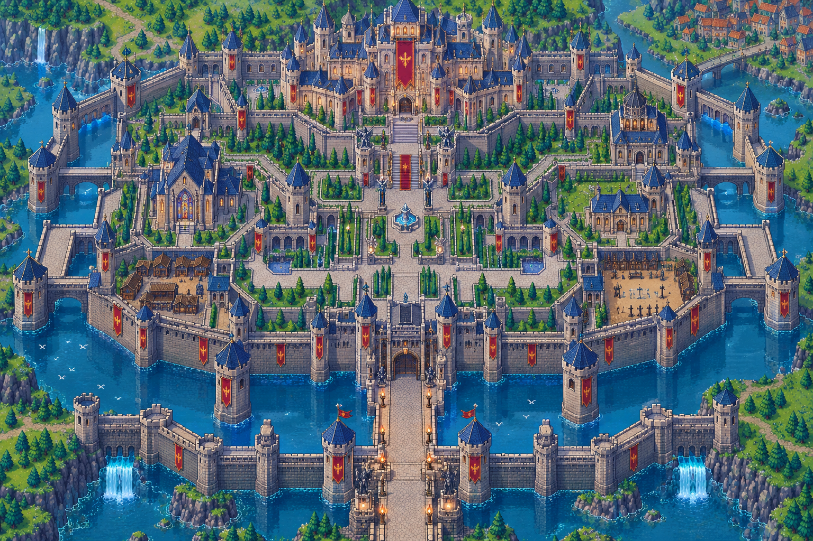

# Grand Castle Island

A 2D HD pixel-art game built in **Godot 4** (4.4+). Step 1: build the castle world.

## Open it
1. `git clone` / `git pull` this repo.
2. Godot → **Import** → select `project.godot`.
3. Press **F5**. You'll see the textured island with animated water. WASD/arrows pan, the mouse wheel zooms, and **R** toggles the reference castle overlay.

## Where things go
| Folder | Contents |
|---|---|
| `docs/CASTLE_OBSERVATION.md` | Full breakdown of the castle: zones, structures, palette, animations, asset checklist, build plan |
| `docs/ASSETS.md` | Every asset, what was processed/straightened, and which castle feature it belongs to |
| `docs/TEXTURE_QUALITY.md` | Render/import settings, shaders, rules for new art |
| `shaders/` | Water, terrain and shore-foam shaders |
| `docs/reference/` | The reference artwork |
| `assets/tilesets/` | terrain, water, walls, floors, roofs |
| `assets/sprites/` | towers, buildings, statues, banners, props, vegetation, ambient |
| `assets/effects/` | torch, water, waterfall animations |
| `scenes/castle/Castle.tscn` | Main castle scene (Ground / Floors / Walls tile layers + Y-sorted objects) |
| `scripts/` | GDScript |

## Status
- [x] Castle observed & documented
- [x] Project skeleton + reference scene
- [x] Assets uploaded, backgrounds removed, tilted assets straightened
- [x] One shared world scale (character = 128 px)
- [x] Seamless ground textures, quality render settings
- [x] Ground & animated water
- [ ] Walls & towers
- [ ] Buildings & props
- [ ] Animation, lighting, collision
