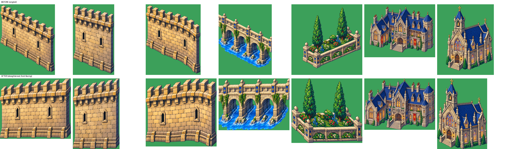

# Asset Guide

77 images from three packs (Surendhar, Bhuvanesh, Gokhul), processed and sorted into `assets/`.

## What was done to every image
1. **Magenta background removed** → real transparency (PNG RGBA), including magenta gaps inside sprites and the pink fringe around edges.
2. **Scale-reference adventurer removed** from the 24 sheets that had him (he was not a game asset).
3. **Trimmed** to the visible content.
4. Seamless textures (water, grass, dirt) left untouched as full-bleed RGB.

## Straightened (tilted → front-facing)
The reference castle is drawn **front-facing (¾ top-down)**. Seven assets were drawn at an angle, so each pixel column was shifted to make the base level. Vertical lines stay vertical, so the pixel detail is preserved.

| File | Was | Now |
|---|---|---|
| `sprites/walls/wall_segment_long.png` | diagonal wall | straight front wall |
| `sprites/walls/wall_segment_short.png` | diagonal wall | straight front wall |
| `sprites/walls/wall_segment_curved.png` | diagonal curved wall | front-facing curved wall |
| `sprites/buildings/aqueduct_bridge.png` | diagonal bridge | side-on arched bridge (the moat bridges in the reference) |
| `sprites/vegetation/cypress_planter.png` | isometric planter | front-facing planter (the avenue planters) |
| `sprites/buildings/manor.png` | slightly angled | front-facing |
| `sprites/buildings/chapel.png` | angled | front-facing |

**Left angled on purpose:**
- `sprites/buildings/taverns_pair.png`: corner views with two equal faces; straightening one face would warp the other. These suit the **town** (top-right), where an angled look is acceptable.
- `sprites/towers/tower_pieces_angled.png`, plus the diagonal pieces in `bridges_walkways_sheet` and `blue_roof_pieces_sheet`: these are **corner pieces** meant to be angled.

## Map: castle feature → asset

| Castle feature (see CASTLE_OBSERVATION.md) | Asset(s) |
|---|---|
| Lake / moat water | `tilesets/water/deep_water`, `shallow_water`, `coastal_shoreline` |
| Grass, dirt paths | `tilesets/terrain/meadow_grass`, `dirt_gravel` |
| Cliffs | `tilesets/terrain/cliff_tileset`, `rocky_cliff_tileset`, `sprites/nature/rocks_sheet` |
| Waterfalls (×3) | `effects/waterfall/waterfall_animation_sheet` (4 frames + splash), `sprites/nature/waterfall_cliff` |
| Rock islets | `sprites/nature/islets_sheet` |
| Causeway / plaza / walkways | `tilesets/floors/flagstone`, `castle_corridor_walkway`, `stone_bridge_walkway` |
| Curtain walls | `sprites/walls/*`, `tilesets/walls/castle_walls_towers_sheet` |
| Towers (blue roofs) | `sprites/towers/round_tower_flat_top` + `blue_cone_roof`, `tower_top_ring`, `tower_base_rings` (incl. in-water version), `turret_tops_finials_sheet` |
| Gatehouse + portcullis | `sprites/buildings/gatehouse`, `castle_gate_parts_sheet`, `doors_gates_portcullis_sheet` |
| Side bridges over moat | `sprites/buildings/aqueduct_bridge`, `sprites/props/bridges_walkways_sheet` |
| Royal palace / keep | `sprites/buildings/palace_facade`, `palace_entrance_keep` |
| Grand staircase | `sprites/props/stairs_with_brazier`, `stairs_platforms_sheet`, carpet in `interior/carpets_drapery_sheet` |
| Cathedral (left) | `sprites/buildings/cathedral_facade` (rose window), `chapel` |
| Domed hall (right) | `sprites/buildings/domed_hall` (near-exact match) |
| Manor (right) | `sprites/buildings/manor` |
| Market (left) | `sprites/props/market_stalls_carts_sheet`, `barrels_crates_sacks_sheet` |
| Training yard (right) | `sprites/interior/armory_sheet` (weapon racks, dummies) |
| Fountains | `sprites/props/fountain_plaza_large`, `fountains_wells_sheet` |
| Statues & gargoyles | `sprites/statues/statues_gargoyles_sheet` |
| Banners & pennants | `sprites/banners/heraldic_banners_sheet` |
| Torches & lanterns | `effects/torch/fire_animation_sheet`, `sprites/props/lanterns_lampposts_sheet`, `sconces_torches_candles_sheet` |
| Trees, cypress columns, hedges | `sprites/vegetation/trees_pines_cypress_bushes`, `flowering_hedge`, `plants_flowers_sheet`, `wetland_plants_sheet` |
| Town (top-right) | `sprites/buildings/taverns_pair` |
| Roofs | `tilesets/roofs/blue_roof_pieces_sheet` |

**Interior** sheets (`sprites/interior/`) and `sprites/items/` are not needed for the castle exterior. They're kept for building interiors later.

## Still missing
- **Seagulls** (`sprites/ambient/` is empty)
- **Water ripple / tower-base splash animation** (`effects/water/` is empty)
- **Fountain spray animation frames** (the fountains are static)
- **Banner sway frames** (optional)

## ⚠ Scale needs a decision
These are high-resolution images. A single building is ~900–1400 px tall, and one "art pixel" is about 4–6 real pixels. The sheets also differ in scale from each other. Before placing them, we need **one common scale**. Two options:
- **(a)** Downscale everything to true pixel size (≈ ÷4), which suits the 16×16 tile plan and a 640×360 screen.
- **(b)** Keep the high-res art and use larger tiles (64×64) at a 1920×1080 base.

Option (a) is the recommended one: it's crisper, lighter on memory, and matches "pixel game".
