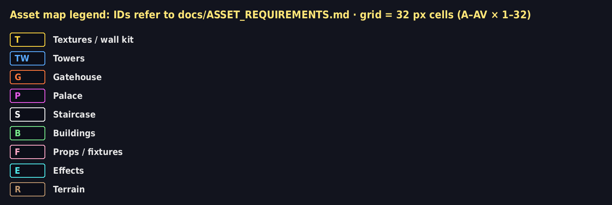
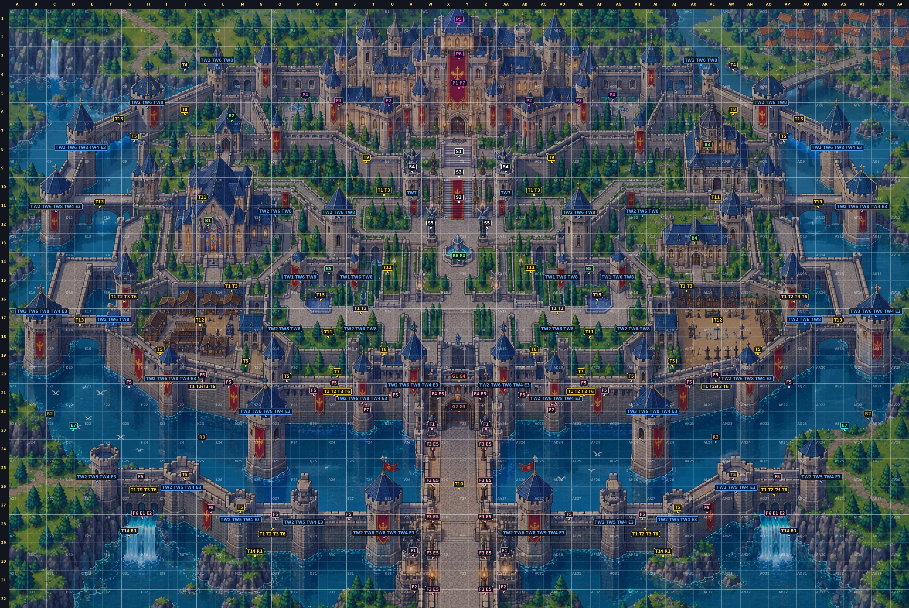

# Asset map: where every asset goes

The original plan with a grid and every asset ID from `docs/ASSET_REQUIREMENTS.md` marked where it is used.

- **Grid:** 32 px cells on the 1536 × 1024 plan. Columns **A–AV** (left → right), rows **1–32** (top → bottom). Cell `K12` = column K, row 12.
- **Full map:** `docs/asset_map/asset_map_full.png` (2×). **Zoomed regions:** `asset_map_palace / west / east / centre / gate_south / barbican_west.png` (3×).
- **Grid only** (no labels, for reference prompts): `asset_map_grid_only.png`. **Every placement with exact coordinates:** `asset_placements.csv`.
- The castle is mirror-symmetric about the line between columns **X** and **Y** (x = 768); most IDs appear on both sides.

## Index

| ID | Uses | Grid cells | Where |
|---|---|---|---|
| **T1** | 16 | G16, H26, K20, L16, O28, R21, S17, U10, AC10, AD17, AE21, AH28, AK16, AL20, AO26, AP16 | barbican face; cathedral terrace face; curtain wall face (diagonal step); curtain wall face (front); curtain wall face (west side); garden terrace face; palace terrace face |
| **T2** | 10 | G16, H26, K20, O28, R21, AE21, AH28, AL20, AO26, AP16 | barbican face; curtain wall face (diagonal step); curtain wall face (front); curtain wall face (west side) |
| **T3** | 16 | G16, H26, K20, L16, O28, R21, S17, U10, AC10, AD17, AE21, AH28, AK16, AL20, AO26, AP16 | barbican face; cathedral terrace face; curtain wall face (diagonal step); curtain wall face (front); curtain wall face (west side); garden terrace face; palace terrace face |
| **T4** | 2 | J4, AM4 | back of wall (seen from behind) |
| **T5** | 12 | G8, I19, J26, M20, M27, O20, AH20, AJ20, AJ27, AM26, AN19, AP8 | wall corner |
| **T6** | 10 | G16, H26, K20, O28, R21, AE21, AH28, AL20, AO26, AP16 | barbican face; curtain wall face (diagonal step); curtain wall face (front); curtain wall face (west side) |
| **T7** | 2 | R20, AE20 | wall-walk on curtain wall |
| **T8** | 4 | J6, U19, AC19, AM6 | lower ward courtyard |
| **T9** | 2 | T9, AC9 | palace terrace paving |
| **T10** | 1 | Y26 | causeway road |
| **T11** | 6 | K11, R18, U15, AB15, AE18, AL11 | cathedral lawn; cypress garden; south garden |
| **T12** | 2 | K17, AL17 | market / training yard |
| **T13** | 6 | D17, E11, F7, AQ7, AR11, AS17 | lower flank bridge; top flank bridge; upper flank bridge |
| **T14** | 4 | G29, N30, AI30, AP29 | rock outcrop under barbican |
| **T15** | 2 | Q16, AF16 | reflecting pool rim |
| **TW1** | 4 | P15, S15, AD15, AG15 | blue tower, scale 0.6, base at y=486 |
| **TW2** | 34 | C11, D8, E26, F17, H6, I21, J26, L4, M28, O12, O18, P28, R12, S18, S22, U29, V21, AA21, AC29, AD18, AD22, AE12, AG28, AH12, AH18, AJ28, AK4, AM26, AN21, AO6, AQ17, AR26, AS8, AT11 | blue tower, scale 0.8, base at y=598; blue tower, scale 0.85, base at y=400; blue tower, scale 0.85, base at y=402; blue tower, scale 0.95, base at y=296; blue tower, scale 0.95, base at y=590; blue tower, scale 1.0, base at y=150; blue tower, scale 1.0, base at y=222; blue tower, scale 1.0, base at y=400; blue tower, scale 1.0, base at y=694; blue tower, scale 1.0, base at y=705; blue tower, scale 1.0, base at y=728; flat tower, scale 1.0, base at y=862; flat tower, scale 1.0, base at y=880; flat tower, scale 1.0, base at y=935; flat tower, scale 1.05, base at y=942; gate tower, scale 1.05, base at y=960 |
| **TW3** | 4 | B17, N22, AI22, AU17 | big tower, scale 1.35, base at y=624; big tower, scale 1.35, base at y=795 |
| **TW4** | 24 | B17, C11, D8, E26, I21, J26, M28, N22, P28, S22, U29, V21, AA21, AC29, AD22, AG28, AI22, AJ28, AM26, AN21, AR26, AS8, AT11, AU17 | big tower, scale 1.35, base at y=624; big tower, scale 1.35, base at y=795; blue tower, scale 0.95, base at y=296; blue tower, scale 1.0, base at y=400; blue tower, scale 1.0, base at y=694; blue tower, scale 1.0, base at y=705; blue tower, scale 1.0, base at y=728; flat tower, scale 1.0, base at y=862; flat tower, scale 1.0, base at y=880; flat tower, scale 1.0, base at y=935; flat tower, scale 1.05, base at y=942; gate tower, scale 1.05, base at y=960 |
| **TW5** | 8 | E26, J26, M28, P28, AG28, AJ28, AM26, AR26 | flat tower, scale 1.0, base at y=862; flat tower, scale 1.0, base at y=880; flat tower, scale 1.0, base at y=935; flat tower, scale 1.05, base at y=942 |
| **TW6** | 34 | B17, C11, D8, F17, H6, I21, L4, N22, O12, O18, P15, R12, S15, S18, S22, U29, V21, AA21, AC29, AD15, AD18, AD22, AE12, AG15, AH12, AH18, AI22, AK4, AN21, AO6, AQ17, AS8, AT11, AU17 | big tower, scale 1.35, base at y=624; big tower, scale 1.35, base at y=795; blue tower, scale 0.6, base at y=486; blue tower, scale 0.8, base at y=598; blue tower, scale 0.85, base at y=400; blue tower, scale 0.85, base at y=402; blue tower, scale 0.95, base at y=296; blue tower, scale 0.95, base at y=590; blue tower, scale 1.0, base at y=150; blue tower, scale 1.0, base at y=222; blue tower, scale 1.0, base at y=400; blue tower, scale 1.0, base at y=694; blue tower, scale 1.0, base at y=705; blue tower, scale 1.0, base at y=728; gate tower, scale 1.05, base at y=960 |
| **TW7** | 2 | V11, AA11 | pillar tower, scale 0.6, base at y=342 |
| **TW8** | 34 | B17, C11, D8, F17, H6, I21, L4, N22, O12, O18, P15, R12, S15, S18, S22, U29, V21, AA21, AC29, AD15, AD18, AD22, AE12, AG15, AH12, AH18, AI22, AK4, AN21, AO6, AQ17, AS8, AT11, AU17 | big tower, scale 1.35, base at y=624; big tower, scale 1.35, base at y=795; blue tower, scale 0.6, base at y=486; blue tower, scale 0.8, base at y=598; blue tower, scale 0.85, base at y=400; blue tower, scale 0.85, base at y=402; blue tower, scale 0.95, base at y=296; blue tower, scale 0.95, base at y=590; blue tower, scale 1.0, base at y=150; blue tower, scale 1.0, base at y=222; blue tower, scale 1.0, base at y=400; blue tower, scale 1.0, base at y=694; blue tower, scale 1.0, base at y=705; blue tower, scale 1.0, base at y=728; gate tower, scale 1.05, base at y=960 |
| **TW9** | 2 | U29, AC29 | gate tower, scale 1.05, base at y=960 |
| **G1** | 1 | Y20 | main gatehouse |
| **G2** | 1 | Y22 | portcullis + doors |
| **G3** | 1 | Y22 | portcullis + doors |
| **G4** | 1 | Y20 | main gatehouse |
| **P1** | 1 | Y5 | central keep |
| **P2** | 2 | U6, AB6 | wing segment A |
| **P3** | 2 | R6, AE6 | wing segment B |
| **P4** | 2 | P5, AG5 | corner pavilion |
| **P5** | 1 | Y1 | back turret silhouette (behind) |
| **P6** | 1 | Y3 | giant banner |
| **P7** | 1 | Y5 | central keep |
| **S1** | 1 | Y8 | upper flight (plain) |
| **S2** | 1 | Y11 | lower flight (carpet) |
| **S3** | 1 | Y9 | landing balustrade |
| **S4** | 2 | V9, AA9 | gargoyle on pillar |
| **S5** | 2 | W12, Z12 | knight at stair foot |
| **B1** | 1 | K12 | cathedral |
| **B2** | 1 | L6 | chapel |
| **B3** | 1 | AL8 | domed hall |
| **B4** | 1 | AK13 | manor |
| **B5** | 2 | R15, AE15 | arched colonnade |
| **B6** | 1 | Y14 | central fountain |
| **F1** | 4 | V30, W23, Z23, AA30 | knight statue at the gate; knight statue, barbican landing |
| **F2** | 2 | V32, AA32 | lantern pillar |
| **F3** | 10 | W24, W26, W28, W30, W32, Z24, Z26, Z28, Z30, Z32 | causeway brazier |
| **F4** | 2 | W21, Z21 | gate wall torch |
| **F5** | 20 | G21, H26, K21, K27, L21, O28, Q21, R21, S28, U21, AB21, AD28, AE21, AF21, AH28, AK21, AL21, AL27, AO26, AP21 | wall banner (barbican); wall banner (curtain wall) |
| **F6** | 2 | H28, AO28 | sluice grates + waterfall + splash |
| **F7** | 2 | T22, AC22 | wall decals (slits, spouts, ivy) |
| **E1** | 2 | H28, AO28 | sluice grates + waterfall + splash |
| **E2** | 2 | H28, AO28 | sluice grates + waterfall + splash |
| **E3** | 24 | B17, C11, D8, E26, I21, J26, M28, N22, P28, S22, U29, V21, AA21, AC29, AD22, AG28, AI22, AJ28, AM26, AN21, AR26, AS8, AT11, AU17 | big tower, scale 1.35, base at y=624; big tower, scale 1.35, base at y=795; blue tower, scale 0.95, base at y=296; blue tower, scale 1.0, base at y=400; blue tower, scale 1.0, base at y=694; blue tower, scale 1.0, base at y=705; blue tower, scale 1.0, base at y=728; flat tower, scale 1.0, base at y=862; flat tower, scale 1.0, base at y=880; flat tower, scale 1.0, base at y=935; flat tower, scale 1.05, base at y=942; gate tower, scale 1.05, base at y=960 |
| **E4** | 1 | Y14 | central fountain |
| **E5** | 12 | W21, W24, W26, W28, W30, W32, Z21, Z24, Z26, Z28, Z30, Z32 | causeway brazier; gate wall torch |
| **E7** | 2 | D23, AS23 | seagulls (optional) |
| **R1** | 4 | G29, N30, AI30, AP29 | rock outcrop under barbican |
| **R2** | 2 | C22, AT22 | moat shore edge |
| **R3** | 2 | K24, AL24 | moat water |

## How to use it to generate art

1. Find the ID in `ASSET_REQUIREMENTS.md` for its size, frames and rules.
2. Crop the plan at the listed grid cells (`asset_map_grid_only.png`) and use that crop as the visual reference for that asset.
3. Deliver at the listed size into `assets/castle_hd/`, named after the ID, e.g. `TW2_tower_m_body.png`.
