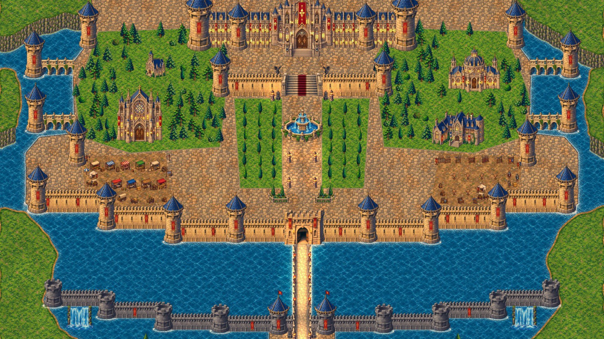
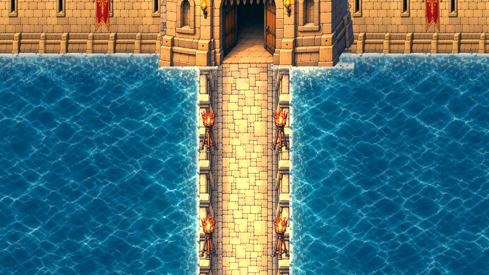
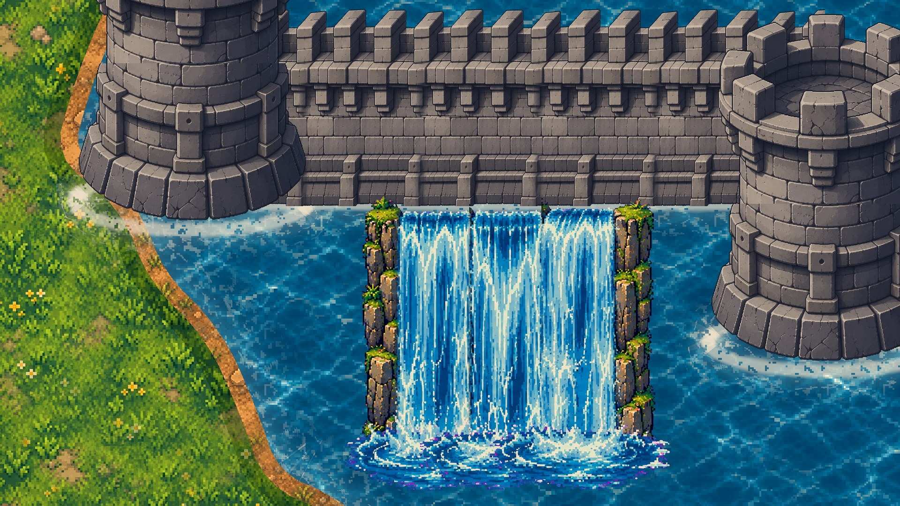
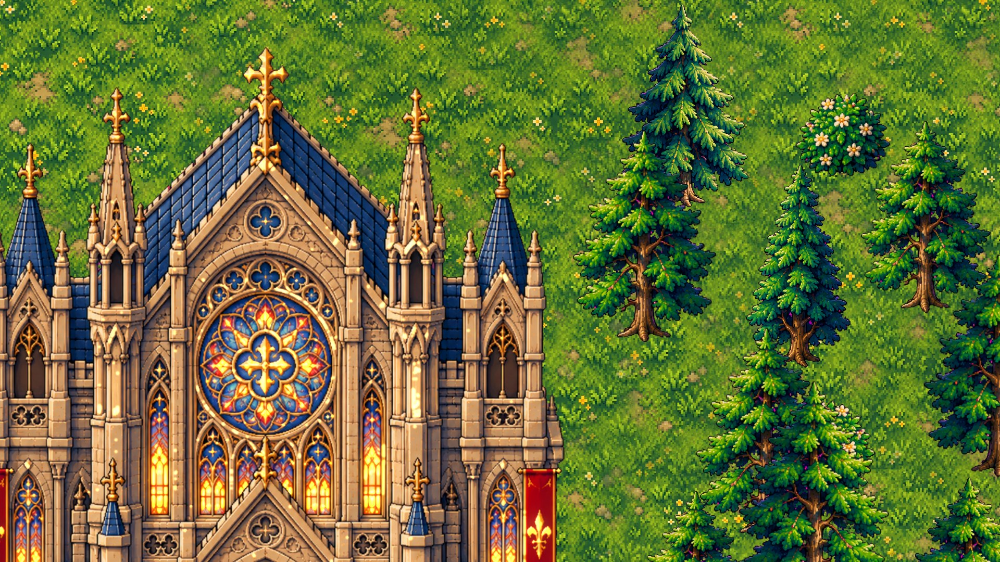

# Texture quality setup

What's done so textures look rich in play, and the rules to keep for new art.

| Setting | Value | Why |
|---|---|---|
| Base resolution | 1920×1080, `canvas_items` stretch | HD pixel art is shown at its authored detail; no low-res upscale blur |
| Texture import | **Lossless**, mipmaps on, fix alpha border | No VRAM compression blocks on hand-painted art; clean edges |
| Default filter | Nearest + mipmaps | Crisp pixels up close, no shimmer/moire when zoomed out |
| 2D pixel snap | On | No half-pixel wobble while the camera moves |
| HDR 2D | On | Torches and windows can glow (bloom) once lights are added |
| Renderer | Forward+ (desktop) | Needed for 2D HDR glow |

## Shaders (`shaders/`)
- **water.gdshader**: two layers of the painted water drift in different directions with noise distortion, plus a sparkle where crests overlap. Motion snaps to the art-pixel grid, so water animates like pixel art instead of smearing.
- **terrain.gdshader**: world-space mapping, so neighbouring areas line up. Large-scale noise varies brightness, blends in a second offset sample, and adds grime patches and a warm/cool colour drift, so the 1024 px tile never reads as a grid.
- **shore_foam.gdshader**: broken, lacy foam right at the bank, waves rolling in toward shore, and a lighter shallow band.

## Rules for new assets
1. Character = 128 px tall. Scale new art to match before importing (see the scale table in ASSETS.md).
2. Ground textures must tile seamlessly (test with a 2×2 repeat).
3. Light comes from the upper-left, warm.
4. Keep PNGs lossless. Never set an asset to VRAM compressed.

## Preview
`scripts/tools/capture.gd` renders review screenshots:
`godot --path . -s res://scripts/tools/capture.gd -- <out_dir>`

## Lighting and animation
- **Day/night** (`scripts/castle/day_night.gd`, key **N**): drives a `CanvasModulate` world tint and the global shader value `night`. Default is golden hour.
- **Window glow** (`shaders/building_glow.gdshader`): each building has a mask of its lit-window pixels in `assets/sprites/buildings/glow/`. The windows brighten above 1.0 as night falls and bloom through the `WorldEnvironment` glow. Sandstone walls and towers are left out because the mask can't tell their sunlit faces from windows.
- **Firelight** (`scripts/castle/flicker_light.gd`): `PointLight2D`s on braziers, lantern pillars and the gate torches, with noise-driven flicker that brightens at night.
- **Flames**: 6-frame animated fire on every brazier.
- **Banners** (`shaders/banner_sway.gdshader`): pinned at the top and swinging at the tail, each with its own phase.
- **Fountain** (`shaders/fountain_water.gdshader`): ripples and sparkles on the painted water, shimmer on the spray.
